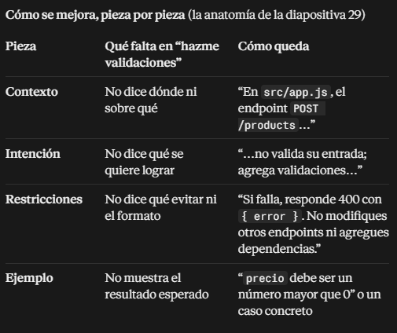

# Guía del instructor: ejercicios paso a paso

Cada ejercicio sigue el mismo ritmo de cinco pasos, y esta guía te da el guion de cada uno con las diapositivas y los archivos del repo de alumnos. Complementa a la [guía por bloques](guia-instructor.md).

## Cómo usar esta guía

1. **Presenta** el ejercicio con su diapositiva (2 min): objetivo, tiempo y qué se entrega.
2. **Demuestra** en vivo lo mínimo necesario (3 a 5 min).
3. **Que arranquen.** Les indicas el `README.md` de su carpeta en `ejercicios/`.
4. **Circula** con las señales de alerta de cada ejercicio.
5. **Cierra** (3 min) con la pregunta final, para que cada alumno diga qué hizo Copilot que no esperaba.

| Ejercicio | Diapositivas | Carpeta de alumnos | Tiempo |
| --- | --- | --- | --- |
| 0. Verificar el entorno | Antes del curso | `ejercicios/ej0-verificar-entorno/` | 10 min |
| 1. Autocompletado | 15, 16 y 17 | `ejercicios/ej1-autocompletado/` | 30 + 50 min |
| 2. Chat, instrucciones y skill | 18 a 28 | `ejercicios/ej2-chat-contexto-prompting/` y `.github/` | 30 min |
| 3. Código legacy | 29 a 31 | `ejercicios/ej3-codigo-legacy/` | 30 min |
| 4. Descuentos con el agente | 32 a 36 | `src/` | 55 min |
| 5. Mockup a React | 37 | `web/` | 30 min |
| Opcional: revisar un PR | 39 a 41 | `ejercicios/ej-opcional-revision-pr/` | 20 min |

**Regla para todos:** commit al terminar cada ejercicio (`git add -A && git commit -m "Ejercicio N"`) y trabajar en la rama `main` de su propia copia, nunca en el repo del instructor.

## Ejercicio 0: verificar el entorno (10 min)

El objetivo es descubrir los problemas de entorno antes del autocompletado, porque después todos van a ritmos distintos. Idealmente se hace antes del curso; si no, es lo primero del día.

**Antes de empezar:** confirma que la plantilla es pública o que todos tienen acceso, y que cada alumno ya tiene su copia (*Use this template*).

0. Crear su repositorio a través del template: https://github.com/MariluRomero13/copilot-curso-alumnos
1. Pide que abran su copia VS Code.
2. Que ejecuten `npm install` y `npm test`. Deben ver **3 pruebas pasando**.
3. Que ejecuten `npm start` y abran `http://localhost:5000/products`. Después `Ctrl+C`.
4. **Comprobación de Copilot,** en este orden:
    - Escribir un comentario en un archivo y ver el texto gris (ghost text).
    - Abrir el chat (`Ctrl+Alt+I`) y confirmar que ven el selector de agentes (Agent, Plan, Ask).
    - Ejecutar *Chat: Open Customizations* desde la paleta (`Ctrl+Shift+P`).
5. Primer commit de control: `git commit --allow-empty -m "Entorno verificado"`.

**Señales de alerta**

- Node.js menor a 20 o instalación sin terminar: el alumno no pasará `npm test`.
- No ven el selector de agentes: versión antigua de VS Code o distinto destino de sesión. Pide que actualicen o revisa el selector del chat.
- Licencia inactiva: se nota porque no hay ghost text ni respuesta en el chat.

**Cierre:** pide que levanten la mano quienes **no** terminaron los cinco pasos y resuélvelo antes de seguir.

## Ejercicio 1: autocompletado (30 + 50 min)

**Diapositivas:** 15 (tres técnicas), 16 (cuatro teclas) y 17 (el ejercicio). **Regla del ejercicio:** nada de chat, solo autocompletado, comentarios y NES.

**Antes de empezar (5 min)**

1. Muestra las cuatro teclas de la diapositiva 19: `Tab`, `Esc`, `Alt + ]` y `Ctrl + Der.` En teclados en español `Alt + ]` suele chocar, así que pide que lo reasignen si no responde.
2. Abre `tramoA_ghostText.js` y haz una demo: borra el cuerpo de una función y deja que Copilot la complete.

**Tramo A: ghost text (10 min)** · `tramoA_ghostText.js`

1. Que borren el cuerpo de cada función y escriban solo la firma. Juntar las llaves, dar CRTL + Enter y ver que sugerencia hace copilot.
2. Que practiquen aceptar, descartar, alternar y aceptar palabra por palabra.
3. En `esEmailValido`, que prueben `a@b`, `a@@b.com` y un correo vacío. La idea es que una sugerencia puede verse bien y estar mal.
    * En la terminal abrir cd ejercicios/ej1-autocompletado, node -i,
    * Cargar: const { esEmailValido } = require('./tramoA_ghostText');
    * Probar la función con: esEmailValido('a@@b.com');
    * Para salir con CRTL+C
4. Entregable: las 4 funciones y una nota con **una sugerencia que rechazaron** y por qué.

**Tramo B: por comentarios (10 min)** · `tramoB_comentarios.js`

1. Bajo cada comentario escriben la firma y dejan que Copilot complete.
2. Si no es lo esperado, **mejoran el comentario, no el código.**
3. Prueban con `PRODUCTOS` en `node -i`. Entregable: 4 funciones y cuántos comentarios reescribieron.

**Tramo C: Next Edit Suggestions (10 min)** · `tramoC_nes.js`

1. Confirman que `github.copilot.nextEditSuggestions.enabled` está activo.
2. En `crearProducto` cambian `nombre` por `nombreComercial` y siguen las sugerencias con `Tab`, revisando cada una.
3. Ojo con la desestructuración `({ nombre })` y con los accesos `p.nombre`. Al final buscan con `Ctrl+F` si quedó alguna referencia a `nombre`.

**Ejercicio completo: inventario (50 min)** · `inventario.js`

1. Escriben un comentario JSDoc de la clase y construyen `Inventario` con `agregar`, `eliminar`, `buscar`, `stockBajo`, `proximosACaducar` y `reporte`, exportada con `module.exports = { Inventario }`.
2. Validan con `npm run test:ej -- ej1`. Deben pasar las 8 pruebas de `inventario.test.js`, que **no se modifican.**
3. Criterios: JSDoc en todos los métodos, sin chat y capaces de explicar cada línea.
4. Para quien termina antes: `actualizarStock(sku, delta)` sin permitir stock negativo, con dos pruebas escritas a mano.

**Señales de alerta**

- Alguien abre el chat: recuérdales la regla, porque el objetivo es sentir cómo el contexto mejora el ghost text.
- `proximosACaducar` con fechas: es el método más delicado: incluye productos ya caducados y el orden de urgencia, así que conviene revisarlo con las pruebas.
- Aceptan todo con `Tab` sin leer: haz que expliquen en voz alta una función elegida al azar.

**Cierre (3 min):** ¿qué sugerencia rechazaron y qué les hizo dudar de ella?

## Ejercicio 2: chat, instrucciones y skill (30 min)

**Antes de este ejercicio** das los módulos de chat, contexto y prompting con las diapositivas 18 a 28. **Para este ejercicio:** diapositiva 32. Archivos: `ejercicios/ej2-chat-contexto-prompting/utilidades.js` y `src/app.js`.

**Demo previa (5 min, dentro del bloque 4)**

1. Crea `.github/copilot-instructions.md` con la regla "Empieza cada respuesta con *Hola equipo*".
2. Abre un chat **nuevo**, ejecuta *Chat: Open Customizations* y muestra que la regla aparece. Haz una pregunta y revisa *References* en la respuesta.
3. Borra la regla de prueba. Esa verificación es lo que ellos repetirán con sus reglas reales.

**Parte 1: chat, comandos y modelos (8 min)** · `utilidades.js` tiene cuatro funciones `f1` a `f4` con nombres crípticos y `var`.

1. `f1` con inline chat (`Ctrl+I`): renombrar con nombres descriptivos, usar `const` y `let` y agregar JSDoc.
2. `f2` con inline chat: pedir JSDoc en español con parámetros, retorno y un ejemplo. Si no aparece, la instrucción debe ser explícita.
3. `f3`: pedir que explique la función. El promedio móvil falla en los últimos elementos: que **pidan la causa antes de aceptar el arreglo.**
4. `f4`: ¿Qué hace esta función y qué pasa si pct es mayor que 100 o negativo?
5. Con el agente **Ask**, la misma pregunta con dos modelos (uno específico y **Auto**) y anotar cuál respondió mejor y por qué.

**Parte 2: contexto e instrucciones (10 min)**

1. Adjuntan `src/app.js` (Add Context o arrastrando) y preguntan qué validaciones faltan en `POST /products`.
2. Lanzar el promopt: ¿Qué validaciones le faltan al endpoint POST /products? Lista cada una con el caso concreto que fallaría.
3. Lanzar el siguiente prompt: Agrega una función en src/app.js que valide el campo precio de un producto.
5. Crean `.github/copilot-instructions.md` con **al menos 4 reglas verificables** (por ejemplo `const` y `let` en vez de `var`, JSDoc obligatorio en cada función, nombres en español, validar la entrada).
6. **Verifican que se cargó:** *Open Customizations*, chat nuevo, *References*.
7. Crean una skill con `/create-skill`, o a mano en `.github/skills/revisar-endpoint/SKILL.md`, que revise un endpoint y devuelva una tabla de problemas, y la ejecutan con `/revisar-endpoint`.

**Parte 3: mejora un prompt (12 min)**

1. Ejecutan "hazme validaciones" tal cual en un Chat nuevo, sin contexto y guardan la respuesta en un archivo de notas. Normalmente es genérica: no sabe de qué validaciones hablas, ni en qué archivo, ni qué devolver.
2. Lo reescriben con contexto, intención, restricciones y ejemplo (diapositivas 29 y 30) y comparan.
3. La respuesta casi sirve: **iteran** con un mensaje de seguimiento preciso, sin empezar de cero.
4. Guardan el prompt vago, el mejorado y el mensaje de iteración.
5. Abre otro chat nuevo, adjunta src/app.js y escribe el prompt mejorado.
6. 
7. Después del prompt, lanza lo siguiente: Está bien, pero el mensaje de error debe decir qué campo falló. Haz que devuelva todos los errores a la vez en un arreglo.
8. Entregable final: Ll prompt vago, el mejorado y el mensaje de iteración, y comparan las respuestas.
9. "Mientras más sepa Copilot de dónde, qué, cómo y con qué límites, menos tiene que adivinar."

**Señales de alerta**

- "Mi regla no funciona": casi siempre abrieron el mismo chat de antes. Debe ser un chat nuevo.
- El JSDoc no aparece aunque esté el archivo: la regla no lo pide de forma explícita.
- La skill no se reconoce: revisa el destino de la sesión y la ruta `.github/skills/<nombre>/SKILL.md`. Los prompt files solo funcionan en el harness Local.
- Reglas vagas como "escribe buen código": pídeles que las vuelvan verificables.

**Cierre (3 min):** muestra la diapositiva 26 ("guía, no garantía") y pregunta qué regla no se cumplió y cómo la reescribieron.

## Ejercicio 3: rescatar el script legacy (30 min)

**Diapositivas:** 29 a 31 (cómo entender código ajeno). Carpeta: `ejercicios/ej3-codigo-legacy/`. Se ejecuta con `node reporte_ventas.js ventas.csv` y debe mostrar el top 3 de vendedores, el ticket promedio por sucursal y el total.

**Teoría previa (10 min):** panorama con Ask, detalle por selección, mapa de dependencias y el reporte de bug (esperado, obtenido, reproducción). Regla: **primero la causa, después la corrección.**

**Solo para el instructor: los 3 bugs.** Ninguno detiene el programa.

| # | Bug | Cómo se ve | Cómo lo detectan |
| --- | --- | --- | --- |
| 1 | El ciclo usa `i < r.length - 1` y **omite la última venta** | Luis suma 3398 y debería sumar 5196. El total muestra 34113 y debería ser 35911 | Calcular a mano los totales por vendedor y el total general |
| 2 | El orden compara los totales como **texto**, no como números | Marta (17841) no aparece en el top 3, aunque es la primera. El top correcto es Marta, Ana (9475) y Luis (5196) | Calcular a mano el total de Marta |
| 3 | `Occidente` no tiene ventas y el promedio divide `0 / 0` | Imprime `NaN` en el ticket de Occidente | Leer la salida: aparece `NaN` |

**Parte 1: entender (10 min), sin leer el código antes**

1. Con el agente Ask: "Resume qué hace este script, sus entradas y sus salidas."
2. Seleccionan la función `f` y piden que la explique por bloques.
3. Piden nombres descriptivos para `f`, `d`, `r`, `t`, `g`, `s`, `k`.
4. Con el agente Agent (o adjuntando `ventas.csv`): "¿Qué columnas del CSV usa el script y en qué posición?"
5. Entregable: un párrafo de 3 a 5 líneas con **sus palabras.**

**Parte 2: diagnosticar y corregir (15 min)**

1. Ejecutan el script y revisan la salida: ¿algo parece raro?
2. Por cada problema, escriben el reporte de bug (esperado, obtenido, reproducción).
3. Piden a Copilot **la causa** antes de la corrección y aplican el arreglo.
4. **Verifican ejecutando otra vez** y calculando a mano el total de `Marta`.

**Parte 3: dejarlo mejor (5 min):** refactor con nombres descriptivos, funciones pequeñas y `const`/`let`, sin cambiar el resultado.

**Criterios:** los números coinciden con el cálculo manual, no aparecen `NaN` ni `Infinity`, y por cada bug anotaron qué fallaba, por qué y cómo lo detectaron.

**Señales de alerta**

- Un "arreglo" que convierte `NaN` en `0`: esconde el problema en vez de resolverlo. Es el ejemplo ideal para el cierre.
- Corrigen el bug 3 y creen que terminaron: el 1 y el 2 solo se ven calculando a mano.
- Aceptan el refactor sin comparar la salida con la versión corregida.

**Cierre (3 min):** ¿qué bug fue el más difícil de detectar y hubo algún arreglo de Copilot que ocultaba el problema?

## Ejercicio 4: descuentos con el agente y pruebas (55 min)

**Diapositivas:** 32 (agent mode), 33 (limitar alcance), 34 (pruebas en verde), 35 (cobertura) y 36 (el ejercicio). Proyecto: `src/`, la API Express de la farmacia. El módulo de teoría dura 20 min de agent mode y 10 de pruebas.

### Propósito del ejercicio

Aquí **no se practica programar descuentos**, se practica **dirigir a un agente**: pedirle un plan, limitar su alcance, revisar lo que hace y comprobar que el resultado funciona con pruebas. La lógica de negocio es solo el pretexto. Al terminar, cada alumno debe poder decir:

- Por qué conviene planear antes de ejecutar.
- Qué pasa cuando el agente se sale del alcance y cómo detenerlo.
- Por qué una prueba que pasa no prueba nada si no puede fallar.

### Los tres modos del agente

En el selector del chat hay tres modos. Se eligen según lo que necesitas en ese momento:

| Modo | Qué hace | Toca archivos | Cuándo usarlo |
|---|---|---|---|
| **Ask** | Responde preguntas y explica código | No | Entender algo antes de actuar |
| **Plan** | Investiga el proyecto y propone un plan paso a paso | No (solo propone) | Antes de cualquier cambio de varios archivos |
| **Agent** | Ejecuta: edita archivos, corre comandos en terminal, itera | Sí, con tu aprobación | Después de revisar el plan |

> Edit aparece en versiones anteriores, pero está deprecado. Si algún alumno lo ve, que use Agent.

**Flujo del ejercicio:** Plan (se lee y se ajusta) → Agent (se ejecuta con control) → Ask si quieren que les explique algo que no entendieron.

**Qué decir:** *"Plan piensa y Agent hace. Si saltas el plan, el agente decide por ti. El plan es tu oportunidad de corregirlo antes de que toque un archivo."*

### Por qué se dan las reglas de negocio tal cual

Las reglas se entregan completas y sin ambigüedad por tres razones:

1. **Evitan discutir requisitos.** Si cada alumno inventara las reglas, el tiempo se iría en decidir qué construir y no en practicar cómo dirigir al agente.
2. **Hacen comparables los resultados.** Todos tienen la misma definición de "correcto", y las pruebas de la Parte 3 se escriben contra reglas conocidas.
3. **Practican traducir reglas a un prompt.** Una regla bien escrita (con números, casos límite y qué devuelve) da un mejor plan que una descripción vaga. Es el mismo principio del Ejercicio 2.

**Reglas de negocio (se las das tal cual):**

- Volumen: 5 a 9 piezas = 5 %; 10 o más = 10 %.
- Cupones `SALUD10` (10 %) y `ADULTOMAYOR15` (15 %), sin distinguir mayúsculas.
- Cupón vencido o inexistente = `400`.
- Volumen y cupón se suman con **tope total de 20 %**.
- Si algún producto requiere receta, el pedido necesita `receta` (folio no vacío) o `400`.
- `cantidad` debe ser un entero mayor que cero.
- La respuesta incluye `subtotal`, `descuento`, `porcentaje_descuento` y `total`.

**Restricciones (también tal cual):** la lógica va en un `src/descuentos.js` nuevo; solo se modifican `src/app.js`, `src/descuentos.js` y archivos de pruebas; no se tocan los endpoints de `/products` ni se agregan dependencias.

### El comando `/compact`

Cada conversación con el agente acumula mensajes, diffs y salidas de terminal. Cuando se alarga, el chat **pierde el hilo**: olvida restricciones, repite cosas o responde peor.

`/compact` **resume la conversación** para liberar espacio y conservar lo esencial, sin empezar un chat desde cero.

- **Cuándo usarlo:** la sesión ya es larga (muchos cambios, muchas ejecuciones de pruebas) o el agente empieza a olvidar lo acordado.
- **Cómo:** escribe `/compact` en el chat.
- **Después de compactar:** vuelve a escribir las **restricciones** (archivos permitidos, no tocar `/products`, sin dependencias). Un resumen puede perder detalles, y las restricciones son lo más importante de conservar.
- **Alternativa:** si el tema cambia por completo, un chat nuevo es mejor que compactar.

**Qué decir:** *"Compactar es como sacarle un resumen a la conversación. No es mágico: verifica que el agente siga respetando lo que pediste."*

### Demo previa (8 min)

Pide al agente **Plan**: "agrega el campo `stock_minimo` a los productos y un endpoint `GET /products/bajo-stock`". Ajusta el plan, ejecútalo con **Agent**, recorre los diffs, rechaza un cambio y restaura un checkpoint. Deja claro que **no se activa la aprobación automática.**

### Parte 1: planear (10 min)

1. **Guardan su avance** con un commit (o una rama) para poder volver si algo sale mal: `git add -A && git commit -m "Antes del ejercicio 4"`.
2. Con el agente **Plan** pegan las reglas y las restricciones.
3. Leen el plan y **ajustan al menos una cosa** (por ejemplo, la estructura de datos de los cupones).
4. **No ejecutan todavía.**

### Parte 2: ejecutar con control (20 min)

1. Pasan al agente **Agent** y ejecutan el plan, sin aprobación automática.
2. Leen **cada comando de terminal** antes de aprobarlo.
3. Revisan los diffs por archivo y practican **Undo** en al menos un cambio que no les guste.
4. Prueban un **checkpoint** (restaurar el estado de la sesión a un punto anterior): restauran uno y vuelven a avanzar. Si la sesión se alarga, usan `/compact` y repiten las restricciones.
5. Verifican con `git status` que **solo** se tocaron los archivos permitidos.
6. Prueban a mano con `npm start` en una terminal y `curl -X POST localhost:5000/orders` en otra.
7. **Guardan su avance** con un commit de la versión que funciona. Lo necesitan para la mutación del paso 5 de la Parte 3.

### Parte 3: pruebas en verde (25 min)

1. **Pedir las pruebas (5 min).** Adjuntan `src/descuentos.js` y `src/app.js` y piden pruebas con Jest, y con supertest para `POST /orders`, en `src/tests/descuentos.test.js` y `src/tests/orders.test.js`. Indican el estilo (`test.each`, un caso borde por función) y que **no modifiquen** el código. Leen las pruebas antes de ejecutarlas.
2. **Ejecutar y analizar fallos (7 min).** Piden que ejecute `npm test` y que, por cada fallo, **explique si el error está en la prueba o en el código antes de corregir**. Deciden ellos y corrigen uno por uno hasta llegar a verde.
3. **Casos borde (5 min).** Piden primero la lista de reglas **sin cubrir** y luego agregan solo lo que falte: 4 vs. 5 y 9 vs. 10 piezas, el tope de 20 %, receta ausente, vacía o con solo espacios, cantidad negativa, cero o decimal, cupón vencido, inexistente o en minúsculas, y subtotal cero.
4. **Cobertura (3 min).** `npx jest --selectProjects server --coverage --collectCoverageFrom=src/descuentos.js`. Leen **% Lines** y, si está bajo, **Uncovered Line #s**.
5. **Mutación manual (4 min).** Cambian un `>=` por `>` en `descuentos.js` y ejecutan `npm test`. Si ninguna prueba falla, las pruebas son débiles: agregan el caso de frontera que faltaba. Revierten con `git restore src/descuentos.js`.

**Mensaje clave:** la cobertura mide qué líneas se ejecutaron, no si las pruebas detectan errores. Eso lo demuestra la mutación.

### Criterios

- `npm test` en verde.
- Cobertura de `descuentos.js` mayor o igual a 85 %.
- `git status` solo con los archivos permitidos.
- La mutación hizo fallar al menos una prueba.
- Cupón vencido, cantidad negativa y receta sin folio devuelven `400`.

### Señales de alerta

- El agente instala paquetes o edita `/products`: viola las restricciones. Que lo rechacen y acoten el prompt.
- El agente modifica la **prueba** para que pase en vez de corregir el código.
- Alguien salta el plan y ejecuta de inmediato: pregunta qué habría pasado con un plan revisado.
- Alumnos sin commit previo no pueden deshacer: enséñales `git restore`.
- Después de `/compact` el agente vuelve a tocar archivos no permitidos: repite las restricciones.

### Cierre (3 min)

Reflexión de 3 líneas: ¿qué hizo el agente que no pidieron, qué corrigieron y qué harían distinto en el prompt?

## Ejercicio 5: del mockup a React (30 min + 5 de teoría)

**Diapositivas:** 37 (del mockup al componente) y 37 (el ejercicio). Archivos: `ejercicios/ej5-imagen-a-codigo/mockup-catalogo.png` y `web/`. Necesitan un **modelo con visión**; compruébalo antes, porque no todos los modelos leen imágenes.

**Requisitos del componente:** `web/Catalogo.jsx` renderizado desde `App.jsx`; tarjetas cargadas con `fetch` dentro de `useEffect` desde `GET /products`; etiqueta **"Requiere receta"** como en el mockup; filtro de categoría con `?categoria=`; búsqueda por nombre; solo React y CSS propio, sin librerías de componentes ni de estilos.

**Antes de empezar (2 min):** muestra cómo adjuntar la imagen (Add Context o arrastrarla al chat) y cómo levantar todo en **dos terminales**: `npm start` (API, puerto 5000) y `npm run dev` (Vite, puerto 5173).

**Parte 1: primera versión (10 min)**

1. Seleccionan un modelo con visión y adjuntan `mockup-catalogo.png`.
2. Con el agente Agent escriben un prompt con **contexto, intención y restricciones**: crear `web/Catalogo.jsx` (y su CSS) y usarlo desde `web/App.jsx`.
3. Revisan los diffs y abren `http://localhost:5173`.

**Parte 2: comparar e iterar (15 min)**

1. Ponen el mockup junto a su página y **anotan 3 diferencias visuales concretas** (color del botón, espaciado, tamaño de la etiqueta).
2. Iteran **dos veces** con mensajes precisos: 
    1. Lanzas el siguiente prompt: En escritorio las tarjetas deben ir en 3 columnas con el mismo espaciado del mockup. La etiqueta "Requiere receta" debe tener el mismo color y tamaño que en la imagen.
    2. Lanzas otro prompt: Agrega un estado vacío ("No se encontraron productos") cuando la búsqueda no tenga resultados.
    3. Lanzas otro prompt: Si la API falla, muestra un mensaje de error claro y un botón para reintentar.
    4. Lanzas el ultimo prompt: Haz el diseño responsivo: 1 columna en celular, 2 en tableta y 3 en escritorio.

**Parte 3: revisión (5 min)**

- ¿Pinta con JSX o usa `dangerouslySetInnerHTML`? (riesgo de XSS)
- ¿El `useEffect` limpia la petición si el componente se desmonta o el filtro cambia?
- ¿Funciona con teclado, y el buscador y el selector tienen etiqueta accesible?
- ¿Maneja el error si la API falla?
- Si sobra tiempo: una prueba con React Testing Library que simule `fetch`.

**Criterios:** el catálogo muestra los 6 productos con nombre, categoría y precio; el filtro y la búsqueda funcionan; anotaron 3 diferencias y corrigieron al menos 2; hay estado vacío, de error o diseño responsivo; identificaron al menos 1 problema de calidad; `npm test` sigue en verde.

**Señales de alerta**

- Usan un modelo sin visión y el resultado no se parece al mockup.
- Solo levantaron Vite y la API no está corriendo, así que el catálogo sale vacío.
- Aceptan la primera versión sin comparar contra el mockup.
- Añaden una librería de estilos o de componentes: viola la restricción.

**Cierre (3 min):** ¿qué problema de calidad encontraron en el código generado y no se veía en la pantalla?

## Demo del bloque 10 y ejercicio opcional

**Diapositivas:** 39 (cloud agent), 40 (code review y MCP) y 41 (ejercicio opcional). Es una **demo del instructor** de 25 minutos: los alumnos observan, no ejecutan.

### Propósito

Hasta ahora todo pasó dentro del editor. Este bloque muestra que Copilot también trabaja **en GitHub**, alrededor del código: resume cambios, hace tareas por su cuenta y revisa. El mensaje es el mismo del día: Copilot propone, **tú revisas y decides**.

### Conceptos (6 min, antes de la demo)

Explícalos en este orden, porque cada uno se apoya en el anterior. Una frase y un ejemplo, sin diapositivas largas.

**1. Pull request (PR)**
Una propuesta de cambio. Trabajas en una rama aparte, y el PR le pide al equipo: "revisen estos cambios antes de mezclarlos en la rama principal". Contiene los archivos modificados (diff), una descripción y los comentarios de la revisión.
*Qué decir:* "El PR es donde otra persona (o Copilot) mira tu código antes de que llegue a producción."

**2. Code review (revisión de código)**
Alguien lee los cambios de un PR y deja comentarios o los aprueba. Con Copilot, lo agregas como **revisor** del PR y él comenta posibles errores y mejoras.
*Qué decir:* "Copilot es un segundo par de ojos, no el aprobador. Puede dejar falsos positivos o no encontrar nada. La decisión de aprobar sigue siendo tuya."

**3. Cloud agent (agente en la nube)**
Es Copilot trabajando **en GitHub, no en tu editor**. Le asignas un issue, trabaja en segundo plano en su propio entorno, crea una rama y abre un PR con lo que hizo. Tú lo revisas como el de cualquier compañero. A diferencia del modo Agent del IDE, **no estás presente mientras trabaja**.
*Qué decir:* "Agent en VS Code trabaja contigo, al lado. El cloud agent trabaja solo y te entrega un PR. Por eso el issue debe estar muy bien escrito: no puede preguntarte a mitad del camino."

**4. MCP (Model Context Protocol)**
Un estándar para **conectar a Copilot con herramientas y fuentes de datos externas** mediante servidores. Sin MCP, Copilot solo conoce lo que tiene entrenado y lo que ve en tu proyecto. Con MCP puede consultar documentación actual, una base de datos, un sistema de tickets, etc.
*Qué decir:* "Es como un conector USB para la IA. Cada servidor MCP le da una capacidad nueva. Por eso hay que instalar solo servidores de fuentes de confianza: lo que conectas puede leer o hacer cosas."

### Preparación (antes del día del curso)

**Dónde se hace todo:** en un **repositorio de GitHub de demostración** (puede ser una copia del repo maestro en tu cuenta u organización). El cloud agent y el code review viven en GitHub, así que no funcionan con un repo solo local.

**1. Revisa los requisitos**
- Tu plan debe incluir el cloud agent (puede requerir plan de pago).
- En Business y Enterprise, un administrador debe haberlo habilitado en la organización y en el repositorio. Si no ves a Copilot entre los *Assignees*, es lo primero que hay que revisar.
- Haz la prueba **al menos un día antes**: tarda varios minutos y consume créditos.

**2. Crea el issue**
Ve al repositorio de demo → pestaña **Issues** → **New issue**. Escríbelo como si lo recibiera alguien que no puede hacerte preguntas: contexto, qué hacer, criterios de aceptación y restricciones. Después, en el panel derecho, en **Assignees**, selecciona **Copilot**.

Ejemplo de issue (ajústalo a tu repo antes de usarlo):

```
Título: Validar que el precio sea positivo al crear un producto

Contexto
POST /products acepta cualquier valor en `precio`, incluso cero o negativos.
La API está en `src/` (Express, CommonJS) y las pruebas usan Jest + supertest.

Qué hacer
- Rechazar con 400 y un mensaje claro si `precio` no es un número mayor que cero.
- Agregar pruebas en `src/tests/` para precio válido, cero, negativo y texto.

Criterios de aceptación
- `npm test` en verde.
- No se modifica ningún otro endpoint.
- No se agregan dependencias.

Restricciones
- Solo se tocan `src/app.js` y archivos de prueba.
- Sin datos reales: todo es ficticio.
```

Elige una tarea **pequeña y acotada**. Una tarea grande tarda más, cuesta más y es más difícil de revisar en vivo. Evita el mismo tema del Ejercicio 4 para que no se confundan.

**3. Deja el PR del agente listo**
Cuando termine, el agente abre un PR (normalmente un borrador, en una rama propia). Revísalo tú antes del curso: ten claro qué cambió y qué pedirías ajustar.

**4. Prepara el PR de respaldo para el code review**
Copilot puede no dejar ningún comentario, así que ten un PR con errores deliberados. Una opción rápida es crear una rama que agregue los archivos de `ejercicios/ej-opcional-revision-pr/` (`ajusteStock.js` y su prueba) y abrir un PR hacia la rama principal. Ese código ya tiene errores intencionales.

**5. Prepara MCP**
Crea `.vscode/mcp.json` con el servidor de Microsoft Learn y comprueba que conecta en tu cuenta. Una política de la organización puede bloquear MCP.

```json
{
  "servers": {
    "microsoft-learn": {
      "type": "http",
      "url": "https://learn.microsoft.com/api/mcp"
    }
  }
}
```

### Guion de la demo (25 min)

| Min | Qué | Qué decir o hacer |
|---|---|---|
| 0–6 | **Conceptos** | PR, code review, cloud agent y MCP (sección anterior). |
| 6–10 | **Resumen de PR** | Crea un PR y usa el botón de Copilot en la descripción. Léelo antes de publicarlo: si dice algo que no hiciste, corrígelo. |
| 10–15 | **Cloud agent** | Muestra el issue ya asignado y el PR que generó (no esperes en vivo). Recorre el diff como en cualquier PR. Deja un comentario con `@copilot` pidiendo un ajuste pequeño y muestra que responde. |
| 15–20 | **Code review** | Abre el PR de respaldo → **Reviewers** → agrega a **Copilot**. Muestra que sus comentarios son de tipo *Comment* (no aprueban ni bloquean), la opción **Fix with Copilot** y que consume créditos y minutos de Actions. Si no deja comentarios, dilo y úsalo como lección. |
| 20–25 | **MCP** | Con `mcp.json` listo, pregunta en el chat (modo Agent): *"Según la documentación oficial de Microsoft Learn, ¿cómo configuro una variable de entorno en Azure App Service?"* Muestra que consultó la fuente. Recuerda instalar solo servidores de confianza. |

**Qué debe quedar claro al cierre:** el cloud agent y el code review **entregan propuestas**, no decisiones. Siempre hay una persona que revisa y aprueba.

### Ejercicio opcional: revisar un PR (20 min, fuera de la agenda)

`ejercicios/ej-opcional-revision-pr/`

1. Leen `DESCRIPCION_DEL_PR.md` y el código de `ajusteStock.js`, **sin corregir nada** en las partes 1 y 2.
2. Ejecutan `npm run test:ej -- ej-opcional` y prueban la app con `node ejercicios/ej-opcional-revision-pr/demoApp.js` (puerto 5001).
3. Anotan cada hallazgo con qué, dónde, gravedad y cómo lo comprobaron.
4. Piden una revisión a Copilot **después** de anotar los suyos y comparan en una tabla (qué encontró cada uno, falsos positivos, qué verificaron ejecutando).
5. Deciden: aprobar, aprobar con cambios o pedir cambios, con un comentario de 3 a 5 líneas.

**Cuándo usarlo:** para quien termine un ejercicio antes o como tarea posterior. Si vas justo de tiempo, omítelo sin problema.

### Señales de alerta

- Copilot no aparece entre los *Assignees*: el cloud agent no está habilitado en la organización o el repo.
- El agente de la nube tarda más de lo esperado: por eso se prepara con anticipación.
- El code review no deja comentarios: usa el PR de respaldo.
- MCP no conecta: puede ser una política de la organización. Ten una captura de pantalla de respaldo.

### Cierre del día (diapositivas 45 y 46)

Tres ideas para llevarse (revisa, acota, itera), la regla de oro (si no puedes explicar lo que hace una sugerencia, no la aceptes) y recordar que su copia del repo queda con su propio historial de commits.
